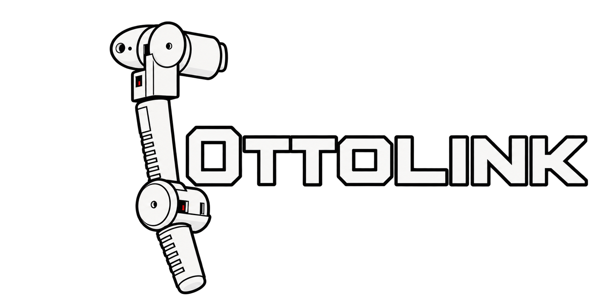

### Design and Control of a 4-DoF Anthropomorphic Robotic Manipulator

Ottolink is a custom 4-DoF anthropomorphic robotic manipulator designed and built for spatial end-effector trajectory execution. The project combines mechanical design, embedded real-time control, Jacobian-based inverse kinematics, custom electronics, and MuJoCo simulation into a complete robotic system.

---

## Overview

Ottolink features a **3-DoF shoulder configuration and 1-DoF pitch elbow**, providing spatial control of the end effector.

The project was developed as a complete robotics pipeline:

**CAD → Mechanical Assembly → Kinematics → Simulation → Embedded Control → Custom PCB → Physical Robot**

The controller runs on an **ATmega328P-based embedded system** and executes Cartesian-space trajectories using a Jacobian pseudoinverse controller.

---

## Features

- 4-DoF anthropomorphic robotic arm
- 3-DoF shoulder + 1-DoF pitch elbow
- Custom mechanical design in Autodesk Inventor
- 3D-printable mechanical components
- Jacobian pseudoinverse inverse kinematics
- Real-time Cartesian-space control
- Custom C++ linear algebra library
- Rodrigues rotation formulation for joint-axis transformations
- Multi-axis synchronized PWM servo control
- Joint interpolation and trajectory execution
- Custom control PCB designed in KiCad
- Dedicated power distribution and voltage regulation
- MuJoCo simulation environment
- Simulation-to-hardware trajectory validation

---

# Mechanical Design

The robotic arm was designed and assembled in **Autodesk Inventor**, with component geometry optimized for 3D printing tolerances.

The mechanical design considers:

- Joint clearances
- Structural rigidity
- Servo mounting
- Payload-to-weight considerations
- Assembly constraints
- Joint-axis alignment

The final design was manufactured using 3D-printed components and integrated with the actuator and control system.

### CAD

The [`CAD/`](CAD/) directory contains the mechanical design files and supporting models.

---

# Kinematics and Control

## Jacobian-Based Cartesian Control

Ottolink uses a **Jacobian pseudoinverse controller** to map Cartesian end-effector errors into joint-space corrections.

Given the end-effector error:

```text
e = x_target - x_current
```

the joint-space update is calculated using:

```text
Δq = J⁺ e
```

where:

- `J` is the manipulator Jacobian
- `J⁺` is the Moore-Penrose pseudoinverse
- `e` is the Cartesian position error
- `Δq` is the resulting joint-space correction

The controller iteratively updates the joint configuration to reduce the Cartesian position error and converge toward the target trajectory.

---

## Rodrigues Rotation

Rodrigues' rotation formula is used to represent arbitrary rotations around the robot's joint axes.

This is particularly important for handling the physical robot's non-ideal axis configurations and maintaining consistency between:

- The CAD model
- The mathematical kinematic model
- The MuJoCo simulation
- The physical robot

---

## Custom Linear Algebra Library

A lightweight custom C++ matrix and linear algebra library was developed specifically for the ATmega328P.

The library provides the operations required by the real-time controller, including:

- Matrix multiplication
- Matrix transposition
- Matrix inversion
- Pseudoinverse operations
- Vector operations

The implementation was designed around the memory and computational constraints of the ATmega328P rather than relying on a large external numerical library.

---

# Embedded Controller

The physical robot is controlled by an **ATmega328P-based embedded system**.

The firmware provides:

- Multi-axis PWM control
- Synchronized servo actuation
- Joint interpolation
- Cartesian trajectory execution
- Real-time kinematic calculations
- Joint-space corrections

The controller was implemented using C++ and PlatformIO.

### Firmware

The embedded controller can be found in:

```text
OttolinkController/
```

The main source code is located in:

```text
OttolinkController/src/
```

---

# Electronics

A custom control PCB was designed in **KiCad**.

The PCB provides:

- Servo power distribution
- Localized voltage regulation
- High-current actuator power handling
- Separation of actuator power from logic-level control signals
- Centralized connections between the microcontroller and actuators

The board was designed to reduce wiring complexity while providing a more robust electrical interface for the robotic system.

### PCB Design

PCB source files are available in:

```text
OttolinkPCB/
```

The directory contains the KiCad schematic, PCB layout, project files, and custom footprint data required for the board.

Manufacturing files are available in:

```text
PCBGerberFiles/
```

---

# Simulation

A complete **MuJoCo simulation** of the robotic arm was developed to validate the kinematic and control system before deployment to the physical hardware.

The simulation includes:

- Robot geometry
- Coordinate frames
- Joint definitions
- Joint limits
- Kinematic transformations
- End-effector control
- Cartesian trajectory execution

The simulation files are located in:

```text
Sim/
├── meshes/
├── ottolink.xml
└── OttolinkSimulation.py
```

The simulation was used to validate:

1. Forward kinematics
2. Coordinate-frame transformations
3. Jacobian calculations
4. Jacobian pseudoinverse control
5. Cartesian trajectory generation
6. Controller behavior prior to physical deployment

---

# Simulation-to-Hardware Workflow

The project was developed with a simulation-first workflow.

```text
        Mechanical Design
               │
               ▼
        Kinematic Model
               │
               ▼
         MuJoCo Model
               │
               ▼
      Controller Validation
               │
               ▼
      Embedded Implementation
               │
               ▼
       Physical Robot
```

This workflow allowed the kinematic and trajectory-control algorithms to be tested in simulation before being executed on the embedded controller and physical hardware.

---

# Repository Structure

```text
Ottolink/
│
├── CAD/
│   ├── Designed/
│   └── Downloaded/
│
├── OttolinkController/
│   ├── include/
│   ├── lib/
│   ├── src/
│   ├── test/
│   └── platformio.ini
│
├── OttolinkPCB/
│   ├── LM2596.pretty/
│   ├── OttolinkPCB.kicad_pcb
│   ├── OttolinkPCB.kicad_pro
│   └── OttolinkPCB.kicad_sch
│
├── PCBGerberFiles/
│
├── Sim/
│   ├── meshes/
│   ├── ottolink.xml
│   └── OttolinkSimulation.py
│
├── Ottolink_Production.mp4
│
├── .gitignore
└── README.md
```

---

# Technologies

### Mechanical Design

- Autodesk Inventor
- Additive manufacturing / 3D printing

### Embedded Systems

- C++
- ATmega328P
- PlatformIO
- PWM servo control

### Robotics

- Forward Kinematics
- Jacobian
- Jacobian Pseudoinverse
- Rodrigues Rotation Formula
- Cartesian-space control
- Joint-space interpolation
- Trajectory generation

### Simulation

- MuJoCo
- Python

### Electronics

- KiCad
- Custom PCB design
- Voltage regulation
- Power distribution

---

# Engineering Highlights

### Mechanical Engineering

Designed a custom 4-DoF anthropomorphic manipulator with consideration for:

- Structural geometry
- Joint clearances
- 3D-printing tolerances
- Servo integration
- Joint-axis alignment
- Assembly constraints

### Robotics and Mathematics

Implemented Cartesian-space control using the Jacobian pseudoinverse and Rodrigues rotation formulation to account for arbitrary and non-ideal joint-axis configurations.

### Embedded Systems

Developed a lightweight C++ linear algebra implementation for the ATmega328P, allowing matrix operations and Jacobian pseudoinverse calculations within constrained embedded memory and computational resources.

### Electronics

Designed a custom KiCad control PCB with dedicated power distribution and localized voltage regulation for high-current servo actuation.

### Simulation

Built a complete MuJoCo representation of the robot to validate kinematics, coordinate transformations, Jacobian control, and Cartesian trajectories before physical deployment.

---

# Results

The completed full stack system integrates the mechanical, electrical, and software components into a functional robotic manipulator capable of executing Cartesian-space trajectories.

The final system demonstrates the complete pipeline from mathematical kinematics and simulation to real-time embedded execution on physical hardware.

---

# Project Status

**Completed — Sept 2026**

The mechanical design, embedded controller, custom PCB, kinematic control system, and MuJoCo simulation have been completed and integrated into the physical robot.

---

## Author

**Arnav Bajaj**

Robotics Engineering Student
